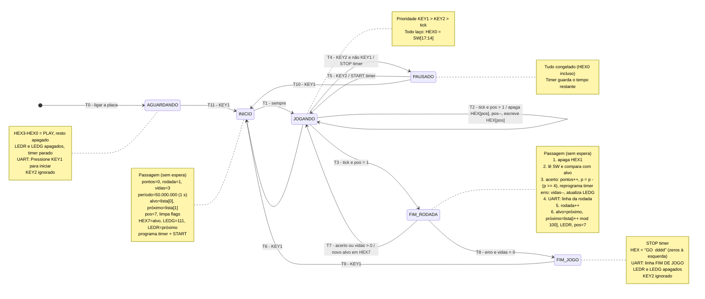

# HexRush – Especificação do jogo

Este documento cobre as etapas 6.1.1 a 6.1.3 do enunciado: as dúvidas levantadas e as decisões tomadas, a máquina de estados, a organização do código e o cronograma (em [`cronograma.md`](cronograma.md)). O modelo formal da máquina de estados em VHDL está em [`hexrush_fsm.vhd`](hexrush_fsm.vhd).

Todas as decisões estão fechadas (as últimas em 26/11).

---

## 1. Decisões tomadas (6.1.1)

### Regras da rodada

| # | Tema | Decisão |
|---|---|---|
| 1 | Quando o erro é detectado | O alvo percorre HEX7 → HEX1 (7 posições). O erro é decidido no passo **seguinte** a HEX1, quando o alvo "chegaria" em HEX0. O jogador tem 7 períodos. |
| 2 | Quando o acerto é verificado | **Somente** quando o alvo chega em HEX0. Não há verificação contínua durante o percurso. |
| 3 | Vidas iniciais | 3, exibidas nos LEDG em unário (`00000111`). |
| 4 | Pontuação | 1 ponto fixo por acerto. Erro não tira pontos. |
| 5 | Início da rodada seguinte | O próximo alvo surge em HEX7 imediatamente. |

### Displays e estados fora da rodada

| # | Tema | Decisão |
|---|---|---|
| 6 | Início | Ao ligar a placa, o jogo **espera o KEY1** (estado AGUARDANDO). Nesse estado: HEX7–HEX4 apagados, HEX3–HEX0 mostram `PLAY` (P = `0x73`, L = `0x38`, A = `0x77`, Y = `0x6E`), LEDR e LEDG apagados, timer parado e a UART imprime `Pressione KEY1 para iniciar` uma vez. KEY2 é ignorado. Depois do fim de jogo, o KEY1 começa uma nova partida direto (não volta ao AGUARDANDO). |
| 7 | HEX0 | Mostra **continuamente** o valor de SW[17:14] em hex (regra 3 do enunciado). O valor a ser atingido é o alvo, que anda. |
| 8 | Pausa (KEY2) | Congela todo o programa, inclusive a atualização de HEX0. KEY1 durante a pausa **reinicia** a partida. |
| 8b | KEY2 no fim de jogo | Ignorado; só KEY1 sai do fim de jogo. |
| 9 | Fim de jogo | HEX7–HEX0 mostram `GO  XXXX`, com a pontuação em decimal e **zeros à esquerda** (ex.: `GO  0007`). G = `0x3D`, O = `0x5C` (o minúsculo, para não confundir com o zero). LEDR e LEDG apagados. |

### Velocidade e temporização

| # | Tema | Decisão |
|---|---|---|
| 10 | Período inicial | 1 s por passo = 50.000.000 ciclos a 50 MHz. |
| 11 | Aceleração | A cada acerto, `p = p − (p >> 4)`, ou seja, redução de **6,25%** do valor atual. Inicialmente eram 5% (`p/20`), mas o processador da placa não tem `div` nem `mul` (item 21); com divisor potência de 2 a conta é um deslocamento só. |
| 12 | Período mínimo | **Sem piso.** Atenção: a regra 7 do enunciado pede um limite mínimo, então isso precisa ser justificado no relatório. Em inteiros, a redução para sozinha quando p < 16 ciclos (p >> 4 vira 0), mas o jogo fica impraticável muito antes: ~524 ms após 10 acertos, ~275 ms após 20, ~40 ms após 50. |
| 13 | Timer | Como no lab da aula (`part2.s`): o período do timer é o próprio passo do alvo, em modo contínuo, com uma interrupção por passo. A cada acerto o período é reprogramado. |

### Alvos

| # | Tema | Decisão |
|---|---|---|
| 14 | Geração dos números | Lista fixa de 100 valores (abaixo). Todos os 16 dígitos aparecem; há 4 repetições seguidas. |
| 14b | Fim da lista | A lista é **circular**: depois do 100º alvo volta ao primeiro (índice mod 100). |
| 14c | Reinício (KEY1) | Toda partida começa no **primeiro** alvo. Por isso a "Sequencia" da linha final é `lista[0..rodada−1]` (com índice mod 100) e não precisa de buffer de histórico. |

Lista (na ordem):

```
e f 0 5 4 0 3 b 2 5   3 4 c 8 7 5 f 8 6 7
f e c 0 1 d 5 9 3 0   a e c 0 8 3 d 3 1 1
2 0 4 3 1 a c 0 d 2   b 8 6 3 e 1 0 2 b f
7 0 9 9 1 9 8 9 9 8   2 e b 8 3 4 3 b 3 d
4 c b e 6 8 f d 9 9   a 9 3 7 b 9 d a 1 8
```

### UART

| # | Tema | Decisão |
|---|---|---|
| 15 | Formato | O mesmo do exemplo do enunciado: ACERTO mostra `Pontos`, ERRO mostra `Vidas`. |

```
Rodada 5 | Alvo: C | Resposta: C | ACERTO | Pontos: 50
Rodada 6 | Alvo: 7 | Resposta: 3 | ERRO   | Vidas: 2
=== FIM DE JOGO === Pontuacao final: 80 | Sequencia: 4A9BC73
```

| 16 | Números | Rodada, pontos e vidas em **decimal, sem zeros à esquerda** (reaproveita a conversão da tela `GO  XXXX`, que está em `utils.s`). |
| 17 | Letras | Dígitos hex na UART em **maiúsculas** (`0123456789ABCDEF`), inclusive b e d. No display continuam `b` e `d` minúsculos. |

### Técnica de acesso aos periféricos

Modelo geral: as ISRs (timer e KEY) **só levantam flags**, e o laço principal faz todo o trabalho. Assim a ISR fica curta (como pede a seção 6.2) e a rotina da UART, que é lenta, nunca roda dentro de uma interrupção.

| Periférico | Técnica | Por quê |
|---|---|---|
| Timer | Interrupção | Evita espera ativa (seção 6.2) e separa temporização da lógica. Custo: salvar e restaurar registradores na ISR. |
| KEY1 / KEY2 | Interrupção | Resposta imediata; a pausa vira só um flag. O edgecapture também guardaria o aperto em polling, mas o laço teria que testar em todos os pontos. |
| SW | Polling | Única opção: a porta das chaves não gera interrupção no Basic Computer. Lida a cada volta do laço (HEX0) e na comparação. |
| JTAG UART | Polling do WSPACE | A FIFO tem 64 posições e cada linha tem ~55 caracteres, então quase nunca espera. Interrupção exigiria um buffer circular só para saída. |
| LEDR, LEDG, HEX | Escrita direta | Só saída; não há o que esperar. |

### Logística

| # | Tema | Decisão |
|---|---|---|
| 17 | Grupo | Gustavo Gomes da Cruz, Gustavo Varjão de Frias, Moisés Nascimento Dearo, Vitor Passagem. |
| 18 | Entrega | 03/12/2026 (3 semanas a partir de 12/11). |
| 19 | Testes | Primariamente na placa física; emulador se necessário. |
| 20 | Placa | **DE2-115** (128 MB de SDRAM; a pilha em `0x01000000` é válida). |
| 21 | Processador | O Nios II do sistema **não tem `div` nem `mul`** em hardware (confirmado na placa em 26/11: o `divu` gerou exceção). Nenhum código usa essas instruções: aceleração por deslocamento e conversão decimal por subtração. |
| 22 | Testes isolados | Todo arquivo em `tests/` tem um tratador mínimo em `0x20` que acende todos os LEDR e trava. Sem ele, uma exceção caía no meio do `_start` e o teste reiniciava sozinho. |

---

## 2. Máquina de estados (6.1.2)



### Estados

#### AGUARDANDO
**Entra:** só ao ligar a placa.
**Ações de entrada:**
1. timer parado (nada de tick)
2. HEX7–HEX4 apagados; HEX3–HEX0 ← `P L A Y`
3. LEDR e LEDG apagados
4. UART: `Pressione KEY1 para iniciar`

**Enquanto está nele:** nada; só espera o KEY1. KEY2 é ignorado.
**Periféricos:** HEX, LEDR, LEDG, UART, KEY (IRQ).

#### INICIO (passagem, sem espera)
**Entra:** com KEY1, vindo de AGUARDANDO, JOGANDO, PAUSADO ou FIM_JOGO.
**Ações de entrada, nesta ordem:**
1. pontos ← 0, rodada ← 1, vidas ← 3
2. período ← 50.000.000 (1 s)
3. índice da lista ← 0 (toda partida começa no primeiro alvo); alvo ← lista[0], próximo ← lista[1]
4. pos ← 7
5. limpa os flags de KEY1, KEY2 e tick, para que um aperto antigo não vaze para a partida nova
6. apaga HEX7–HEX1 e escreve o alvo em HEX7
7. LEDG ← `00000111` e LEDR ← unário do próximo
8. programa o timer com o período e dá START

**Periféricos:** Timer, HEX, LEDG, LEDR.

#### JOGANDO
**Enquanto está nele:** a cada volta do laço, lê SW[17:14] e escreve em HEX0.
**Eventos, nesta prioridade:** KEY1 → KEY2 → tick.
**Periféricos:** SW (polling), HEX, Timer (IRQ), KEY (IRQ).

#### PAUSADO
**Entrada:** STOP no timer (o contador guarda o tempo restante).
**Enquanto está nele:** nada; HEX0 não atualiza e o alvo não anda.
**Saída:** START no timer (continua do tempo restante).
**Periféricos:** Timer, KEY (IRQ).

#### FIM_RODADA (passagem, sem espera)
**Entra:** o alvo estava em HEX1 e chegou o tick.
**Ações, nesta ordem:**
1. apaga o alvo de HEX1
2. lê SW[17:14] → resposta
3. compara a resposta com o alvo
   - acerto: pontos ← pontos + 1; período ← período − (período >> 4); reprograma o timer
   - erro: vidas ← vidas − 1; atualiza LEDG
4. imprime a linha da rodada na UART (já com pontos e vidas atualizados)
5. rodada ← rodada + 1
6. *(só se o jogo continua)* alvo ← próximo; próximo ← lista[(i++) mod 100]; LEDR ← unário do próximo; pos ← 7; escreve o alvo em HEX7

**Periféricos:** SW, Timer, LEDG, LEDR, HEX, UART (polling).

#### FIM_JOGO
**Ações de entrada:**
1. STOP no timer
2. HEX7–HEX0 ← `G O _ _ d d d d`
3. UART: `=== FIM DE JOGO === Pontuacao final: … | Sequencia: …`
4. apaga LEDR e LEDG

**Enquanto está nele:** nada; HEX0 deixa de mostrar SW.
**Periféricos:** HEX, Timer, UART, LEDR, LEDG, KEY (IRQ).

### Transições

| # | De → Para | Condição | Ação |
|---|---|---|---|
| T0 | ● → AGUARDANDO | ligar a placa | — |
| T11 | AGUARDANDO → INICIO | KEY1 | — |
| T1 | INICIO → JOGANDO | sempre | — |
| T2 | JOGANDO → JOGANDO | tick e pos > 1 | apaga HEX[pos]; pos ← pos − 1; escreve o alvo em HEX[pos] |
| T3 | JOGANDO → FIM_RODADA | tick e pos = 1 | — |
| T4 | JOGANDO → PAUSADO | KEY2 e não KEY1 | STOP no timer |
| T5 | PAUSADO → JOGANDO | KEY2 | START no timer |
| T6 | JOGANDO → INICIO | KEY1 | — |
| T7 | FIM_RODADA → JOGANDO | acerto, ou vidas > 0 depois do erro | novo alvo em HEX7 |
| T8 | FIM_RODADA → FIM_JOGO | erro e vidas = 0 depois do erro | — |
| T9 | FIM_JOGO → INICIO | KEY1 | — |
| T10 | PAUSADO → INICIO | KEY1 | — (o INICIO refaz tudo, inclusive o START do timer) |

Observações:
- O AGUARDANDO só existe uma vez, ao ligar a placa: todo KEY1 posterior leva direto ao INICIO.
- T7 e T8 são complementares: uma das duas sempre acontece ao sair de FIM_RODADA.
- O alvo faz T2 seis vezes (7 → 1) e depois T3: são 7 períodos para o jogador acertar.
- No PAUSADO o tick nem chega, porque o timer está parado; KEY1 reinicia (T10). No FIM_JOGO, KEY2 e tick são ignorados.

---

## 3. Organização do código

### Arquivos

| Arquivo | Conteúdo |
|---|---|
| `constants.s` | todos os `.equ`: endereços, período inicial, vidas, deslocamento da aceleração (4), códigos de letras. Incluído pelos outros arquivos com `.include` |
| `main.s` | `_start`, inicialização e laço principal com a FSM |
| `interrupts.s` | RTI em `0x20` (seção `.exceptions`, que o Monitor Program posiciona no endereço de exceção independentemente da ordem dos arquivos) e ISRs do timer e dos KEYs (só levantam flags). Qualquer exceção que não seja interrupção acende todos os LEDR e trava |
| `display.s` | módulo criado a partir do teste atual (`set_hex_digit`), + apagar tudo, tela `PLAY` e tela `GO  XXXX`. O teste isolado vai para `tests/` |
| `leds.s` | LEDR em unário e LEDG com as vidas |
| `timer.s` | iniciar, parar, retomar, reprogramar período, acelerar |
| `uart.s` | enviar caractere e string, número decimal com N dígitos, linha da rodada, linha final e mensagem de espera |
| `targets.s` | a lista de 100 alvos (constante) + rotina que devolve `lista[i mod 100]` |
| `utils.s` | rotinas usadas por mais de um módulo: conversão para decimal (tela GO e UART) |

### Convenção de chamada

A do Nios II: argumentos em r4–r7, retorno em r2 (e r3), r8–r15 livres para a sub-rotina chamada (o chamador perde esses valores a cada `call`), r16–r23 **preservados**: quem usar precisa salvar na pilha e restaurar antes do `ret`. `ra` é salvo na pilha por toda rotina que faz `call`.

### Onde ficam as variáveis do jogo

**Flags na memória, o resto em registradores fixos.** A lista de alvos é constante e fica em `targets.s`.

| Registrador | Variável | Observação |
|---|---|---|
| r16 | pontos | |
| r17 | vidas | |
| r18 | rodada | |
| r19 | pos | display do alvo (7 → 1) |
| r20 | indice | posição na lista (0–99, circular) |
| r21 | periodo | período atual do timer, em ciclos |
| r22, r23 | livres | preservados, para o laço principal usar |

- `alvo` e `proximo` **não** são guardados: são calculados na hora como `lista[indice]` e `lista[indice + 1]` pela rotina de `targets.s`.
- O **estado** da FSM não ocupa registrador: cada estado é um trecho do laço principal com rótulo próprio, e mudar de estado é desviar para ele.
- Os flags (`FLAG_KEY1`, `FLAG_KEY2`, `FLAG_TICK`) ficam na memória, declarados em `main.s` com `.global` (a ISR liga, o laço principal consome e desliga), porque a ISR escreve neles a qualquer momento: ela não pode mexer em um registrador que o laço principal esteja usando.
- Os outros arquivos **não** leem r16–r21 diretamente: recebem o que precisam como argumento (ex.: os pontos chegam em r4 para a rotina da UART). Isso deixa as interfaces explícitas.
- Regras que valem para todos: toda rotina que usar r16–r23 salva e restaura; a ISR só usa `et` e registradores que ela mesma salva e restaura.

### Interfaces das sub-rotinas (6.1.5)

Todas seguem a convenção acima. "—" = sem argumento ou sem retorno.

| Arquivo | Rotina | Entrada | Saída |
|---|---|---|---|
| `display.s` | `set_hex_digit` | r4 = display 0–7, r5 = dígito 0–15 ou `0xFF` (apaga) | — |
| | `set_hex_raw` | r4 = display 0–7, r5 = padrão de 7 segmentos (letras) | — |
| | `clear_hex` | — | — |
| | `show_play` | — | — |
| | `show_game_over` | r4 = pontos | — |
| `leds.s` | `set_ledr_unary` | r4 = n (0–15) | — |
| | `set_ledg_lives` | r4 = vidas | — |
| | `clear_leds` | — | — |
| `timer.s` | `timer_start` | r4 = período em ciclos | — |
| | `timer_stop` | — | — |
| | `timer_resume` | — | — |
| | `next_period` | r4 = período | r2 = período − (período >> 4) |
| `interrupts.s` | `interrupts_init` | — | — (ITO do timer, máscara dos KEYs, `ienable`, PIE) |
| `targets.s` | `get_target` | r4 = índice | r2 = `lista[índice mod 100]` |
| `utils.s` | `to_bcd` | r4 = valor (0–99.999.999) | r2 = o valor em BCD compactado: 8 dígitos decimais, um por nibble |
| `uart.s` | `uart_putc` | r4 = caractere | — |
| | `uart_puts` | r4 = endereço da string terminada em 0 | — |
| | `uart_put_dec` | r4 = valor | — (sem zeros à esquerda) |
| | `uart_put_hex_digit` | r4 = 0–15 | — (maiúscula) |
| | `uart_print_wait` | — | — |
| | `uart_print_round` | r4 = rodada, r5 = alvo, r6 = resposta, r7 = pontos (acerto) ou vidas (erro) | — |
| | `uart_print_end` | r4 = pontos, r5 = nº de rodadas jogadas | — |

- `uart_print_round` decide ACERTO/ERRO comparando r5 com r6, para caber nos 4 registradores de argumento.
- `uart_print_end` monta a "Sequencia" chamando `get_target` de 0 até rodadas − 1.
- `to_bcd` não divide: para cada potência de 10 (10.000.000 até 1) subtrai enquanto der e conta quantas vezes, porque o processador não tem `div`.
- `to_bcd` serve aos dois usos: `show_game_over` pega os 4 nibbles de baixo (com zeros, `GO  0007`), e `uart_put_dec` pula os nibbles zero da esquerda.

---

## 4. Cronograma (6.1.3)

Ver [`cronograma.md`](cronograma.md).
